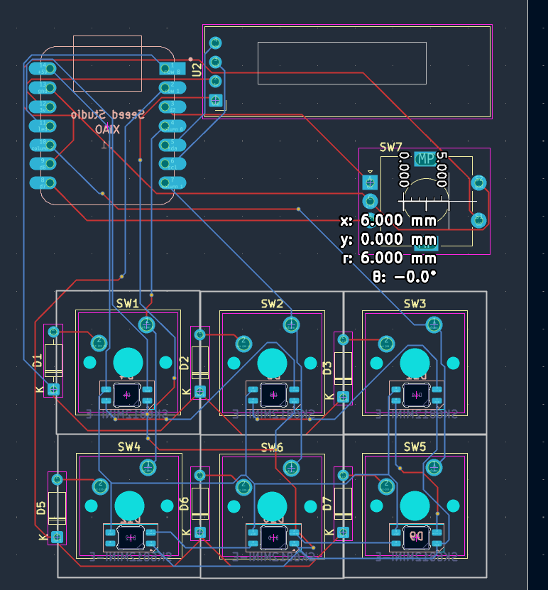
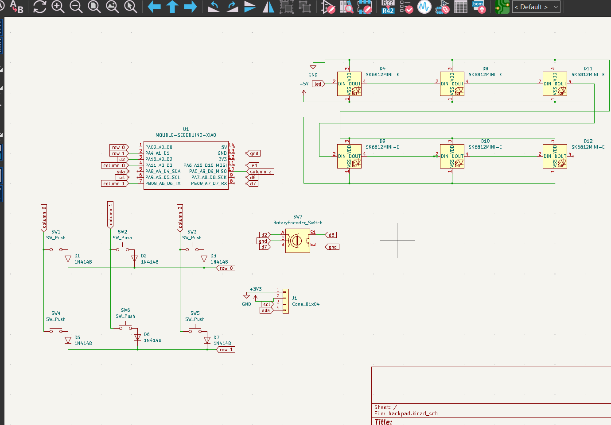

# SpepePad
my own macropad
It has 6 keys, 6 leds to light them up, a rotary encoder, and an oled display!
I made it as a way to introduce myself to basic hardware building skills like pcb design and CAD.

Here is my pcb layout.

Here is the kicad schematic
I have not finished teh CAD yet, but will update the repo ASAP!
